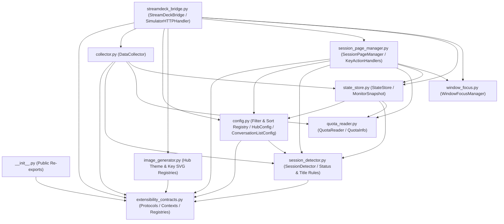
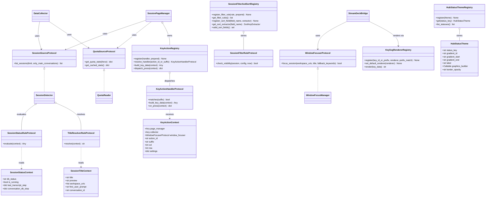

# Antigravity Monitor 拡張アーキテクチャ設計書（OCP / DIP）

## 1. 概要とリファクタリングの目的

`src/antigravity_monitor/` は、Antigravity の稼働セッションおよびレートリミット（クォータ）を監視し、Elgato Stream Deck のキー表示・操作および Web シミュレータへ反映するサブシステムである。

本リファクタリングでは、既存の機能・設定スキーマ・SVG 出力のバイト等価性を 100% 維持したまま、以下の設計原則を適用して拡張性を構造化した。

- **開放閉鎖の原則（Open-Closed Principle: OCP）**:
  - ステータス判定ルール、タイトル解決ルール、セッションのフィルタリング・ソート条件、Hub テーマ SVG、キー描画レンダラー、Stream Deck キーアクションの各処理を、ハードコードされた条件分岐から「プロトコル + レジストリ（パイプライン）」構造へ分離した。
  - 既存のコアクラスやディスパッチ処理を変更することなく、新しいルールやハンドラを登録・差し込みするだけで機能を追加できる。
- **依存性逆転の原則（Dependency Inversion Principle: DIP）**:
  - `DataCollector`、`SessionPageManager`、`StreamDeckBridge` などの上位モジュールが、`SessionDetector`、`QuotaReader`、`WindowFocusManager` といった具象クラスに直接結合するのを避け、共有契約モジュール `extensibility_contracts.py` に定義された `@runtime_checkable` な `Protocol` に依存するよう整理した。
  - デフォルト引数では従来どおり具象実装が自動生成されるため、既存コードや単体テストからの呼び出し互換性はそのまま保たれる。

---

## 2. モジュール構成と依存方向

共有契約（Protocol・コンテキスト dataclass・Registry）を `src/antigravity_monitor/extensibility_contracts.py` に集約し、各ドメインモジュールおよび UI / ブリッジ層が一方向（契約層方向）に依存する構成となっている。



### 各モジュールの役割

| モジュール | 主な責務 | 主な公開シンボル / 拡張関連要素 |
| --- | --- | --- |
| `extensibility_contracts.py` | 共有プロトコル・コンテキスト・レジストリ定義 | `SessionSourceProtocol`, `QuotaSourceProtocol`, `WindowFocuserProtocol`, `SessionStatusRuleProtocol`, `TitleResolverRuleProtocol`, `SessionFilterRuleProtocol`, `SessionFilterAndSortRegistry`, `HubStatusTheme`, `HubStatusThemeRegistry`, `KeySvgRendererRegistry`, `KeyActionHandlerProtocol`, `KeyActionRegistry` |
| `__init__.py` | パッケージ境界での契約・レジストリ再エクスポート | `extensibility_contracts.py` の全 17 公開シンボルを再エクスポート |
| `session_detector.py` | セッション検出と状態・タイトル判定パイプライン | `SessionDetector`, `SessionInfo`, `SessionStatus`, `register_status_rule`, `register_title_resolver`, `DEFAULT_TITLE_RESOLVERS` |
| `config.py` | 設定モデルとフィルタ・ソートのレジストリ管理 | `HubConfig`, `ConversationListConfig`, `DEFAULT_FILTER_SORT_REGISTRY`, `create_default_filter_sort_registry`, `is_session_visible`, `sort_sessions`, `filter_and_sort_sessions` |
| `collector.py` | バックグラウンド収集スレッド制御 | `DataCollector`（`SessionSourceProtocol` / `QuotaSourceProtocol` を注入可能） |
| `state_store.py` | スレッドセーフな状態スナップショット管理 | `StateStore`, `MonitorSnapshot` |
| `quota_reader.py` | `agy` CLI によるクォータ集計とキャッシュ | `QuotaReader`, `QuotaInfo` |
| `window_focus.py` | Windows Win32 API によるウィンドウ最前面化 | `WindowFocusManager`（`WindowFocuserProtocol` 互換） |
| `image_generator.py` | SVG キー画像と Hub テーマ描画レジストリ | `DEFAULT_HUB_THEME_REGISTRY`, `DEFAULT_KEY_SVG_RENDERER_REGISTRY`, `generate_hub_rocket_svg`, `generate_key_svg`, `render_key_svg`, `svg_to_data_uri` |
| `session_page_manager.py` | ページング・キーレイアウト・アクションディスパッチ | `SessionPageManager`, `KeyRenderData`, `create_default_key_action_registry`, `register_key_handler`, `dispatch_key_action` |
| `streamdeck_bridge.py` | Stream Deck WebSocket と HTTP シミュレータ | `StreamDeckBridge`, `SimulatorHTTPHandler`（`WindowFocuserProtocol` / `KeySvgRendererRegistry` / `SessionPageManager` を注入可能） |

---

## 3. プロトコル・レジストリの構造

各拡張領域における `Protocol`、コンテキスト（またはテーマ定義）、レジストリ、および組み込み実装・利用側クラスの関係を以下に示す。



---

## 4. 拡張ポイント一覧

| 拡張領域 | 実装・登録対象の契約 / 型 | レジストリ / 注入先 API | デフォルト構成 |
| --- | --- | --- | --- |
| キーアクション追加 | `KeyActionHandlerProtocol`, `KeyActionContext` | `SessionPageManager.register_key_handler(handler, prepend=True)` または `SessionPageManager(action_registry=...)` | `SummaryHubKeyHandler`, `PaginationKeyHandler`, `SessionSlotKeyHandler`, `QuotaKeyHandler` |
| Hub SVG テーマ追加 | `HubStatusTheme` | `DEFAULT_HUB_THEME_REGISTRY.register(theme)` または `generate_hub_rocket_svg(status, theme_registry=...)` | `"working"`, `"done"`, `"waiting"`, `"empty"`, `"idle"` |
| キー SVG レンダラー追加 | `KeySvgRenderer` (`Callable[[Any], str]`) | `KeySvgRendererRegistry.register(...)` / `StreamDeckBridge(svg_renderer_registry=...)` | `DEFAULT_KEY_SVG_RENDERER_REGISTRY`（`"summary_hub"` のみ個別登録、他は `generate_key_svg`） |
| セッション状態判定ルール | `SessionStatusRuleProtocol`, `SessionStatusContext` | `SessionDetector.register_status_rule(rule, prepend=True)` または `SessionDetector(status_rules=...)` | `ExplicitWaitingStatusRule`, `ConversationDbWaitingRule`, `ToolCallWaitingRule`, `RunningStatusRule` |
| タイトル解決ルール | `TitleResolverRuleProtocol`, `SessionTitleContext` | `SessionDetector.register_title_resolver(resolver, prepend=True)` または `SessionDetector(title_resolvers=...)` | `ExplicitTitleRule`, `PreviewTitleRule`, `WorkspaceUriTitleRule`, `FirstUserPromptTitleRule`, `ConversationIdFallbackTitleRule` |
| セッション可視性フィルタ | `SessionFilterRuleProtocol` | `SessionFilterAndSortRegistry.register_filter_rule(rule, prepend=False)` | `InactiveUnlockedFilterRule`, `ProtectedStatusFilterRule`, `DoneRetentionFilterRule`, `InactivityDaysFilterRule` |
| ソートフィールド追加 | `SortKeyExtractor` (`Callable[[Any, bool], Any]`) | `SessionFilterAndSortRegistry.register_sort_field(field_name, extractor)` | `"status"`, `"updated_at"`, `"title"` |
| データソース / 操作差し替え | `SessionSourceProtocol`, `QuotaSourceProtocol`, `WindowFocuserProtocol` | `DataCollector(...)`, `SessionPageManager(...)`, `StreamDeckBridge(...)` | `SessionDetector`, `QuotaReader`, `WindowFocusManager` |

---

## 5. 具体的な拡張レシピ（Python 実装例）

### 5.1 新しい Stream Deck キーアクションの追加（`KeyActionHandlerProtocol`）

`KeyActionHandlerProtocol` は以下の 3 メソッドを要求する。

- `matches(self, suffix: str) -> bool`: アクション ID の末尾（`action_id.split(".")[-1]`）を担当するかどうかを返す。
- `build_key_data(self, context: KeyActionContext) -> KeyRenderData | None`: キー描画用の `KeyRenderData` を構築する。
- `on_press(self, context: KeyActionContext) -> dict[str, Any]`: キー押下時の処理を実行し、結果辞書を返す。`StreamDeckBridge.handle_key_down` は戻り値に `"page_changed": True` または `"refresh_ui": True` が含まれる場合、自動的に `await self.update_all_keys(force=True)` で全キーを再描画する。

```python
from typing import Any

from src.antigravity_monitor import KeyActionContext
from src.antigravity_monitor.session_page_manager import KeyRenderData, SessionPageManager


class RefreshSessionsKeyHandler:
    """Custom Stream Deck key handler that forces a session refresh on press."""

    def matches(self, suffix: str) -> bool:
        return suffix == "custom_refresh"

    def build_key_data(self, context: KeyActionContext) -> KeyRenderData | None:
        return KeyRenderData(
            key_id="custom_refresh",
            column=context.col,
            row=context.row,
            title="Refresh\nSessions",
            subtitle="READY",
            status="normal",
            bg_color="#00695C",
            payload={"action": "custom_refresh"},
        )

    def on_press(self, context: KeyActionContext) -> dict[str, Any]:
        context.page_manager.refresh(include_quota=True)
        if context.collector is not None:
            context.collector.request_quota_refresh()
        return {
            "status": "ok",
            "action": context.suffix or context.action_id,
            "refresh_ui": True,
        }


page_manager = SessionPageManager()
page_manager.register_key_handler(RefreshSessionsKeyHandler(), prepend=True)

# 描画データの取得（action_id は完全修飾 UUID でもサフィックスでも可）
key_data = page_manager.get_key_data_by_action_id(
    "com.user.antigravity.custom_refresh",
    col=3,
    row=2,
)

# 押下ディスパッチ（StreamDeckBridge.handle_key_down や SimulatorHTTPHandler.handle_api_press からも自動呼び出し）
result = page_manager.dispatch_key_action(
    "com.user.antigravity.custom_refresh",
    col=3,
    row=2,
)
```

**運用上の注意**: `StreamDeckBridge.handle_key_down` および `SimulatorHTTPHandler.handle_api_press` は後方互換性のため、組込みサフィックス（`summary_hub`, `prev_page`, `page_prev`, `next_page`, `page_next`, `session_slot_*`, `quota` を含むサフィックス / `quota_` 接頭辞）を先に判定し、それ以外のアクションを `dispatch_key_action(...)` へ委譲する。新規アクションを追加する場合はこれらと重複しないサフィックスを使用すること。

---

### 5.2 新しい Hub ステータス SVG テーマおよびキー SVG レンダラーの追加

#### Hub ステータス SVG テーマの追加（`HubStatusTheme` / `HubStatusThemeRegistry`）

`HubStatusTheme` を作成し、`DEFAULT_HUB_THEME_REGISTRY.register(...)` または分離された `HubStatusThemeRegistry` インスタンスへ登録する。`HubStatusThemeRegistry.get(status_key)` は `status_key.lower().strip()` で正規化し、未登録キーの場合は `"empty"` テーマ（なければ `"idle"` テーマ）へフォールバックする。

なお、既存の `"empty"` / `"idle"` テーマは外枠の `border_opacity="0.15"` を指定し、`"working"` / `"done"` / `"waiting"` はデフォルトの `"0.2"` を使用することで、従来の SVG 出力とバイト単位で一致させている。

```python
from src.antigravity_monitor import HubStatusTheme, HubStatusThemeRegistry
from src.antigravity_monitor.image_generator import (
    DEFAULT_HUB_THEME_REGISTRY,
    generate_hub_rocket_svg,
)


def _maintenance_graphics() -> str:
    return '  <circle cx="72" cy="58" r="22" fill="#FFFFFF" opacity="0.9" />'


custom_theme = HubStatusTheme(
    status_key="maintenance",
    gradient_id="bgMaintenance",
    gradient_start="#6A1B9A",
    gradient_end="#4A148C",
    label="MAINT",
    graphics_builder=_maintenance_graphics,
    border_opacity="0.25",
)

# グローバル既定レジストリへ登録する場合
DEFAULT_HUB_THEME_REGISTRY.register(custom_theme)
svg_global = generate_hub_rocket_svg("maintenance")

# テストや用途別で隔離されたレジストリを使う場合
isolated_registry = HubStatusThemeRegistry()
for key in DEFAULT_HUB_THEME_REGISTRY.list_statuses():
    isolated_registry.register(DEFAULT_HUB_THEME_REGISTRY.get(key))
isolated_registry.register(custom_theme)
svg_isolated = generate_hub_rocket_svg("  MAINTENANCE ", theme_registry=isolated_registry)
```

#### キー単位・プレフィックス単位の SVG レンダラーの追加（`KeySvgRendererRegistry`）

`KeySvgRendererRegistry` は `key_data.key_id` に対して以下の優先順位でレンダラーを解決する。

1. 完全一致（`register(key_id, renderer, prefix_match=False)`）
2. 最長プレフィックス一致（`register(prefix, renderer, prefix_match=True)`）
3. 既定レンダラー（`set_default_renderer(renderer)`）

```python
from typing import Any

from src.antigravity_monitor import KeySvgRendererRegistry
from src.antigravity_monitor.image_generator import (
    DEFAULT_KEY_SVG_RENDERER_REGISTRY,
    generate_key_svg,
    render_key_svg,
)
from src.antigravity_monitor.session_page_manager import KeyRenderData
from src.antigravity_monitor.streamdeck_bridge import StreamDeckBridge


def render_custom_badge(key_data: Any) -> str:
    return generate_key_svg(
        title=key_data.title,
        subtitle=key_data.subtitle,
        status_label="CUSTOM",
        bg_color=key_data.bg_color,
        accent_color="#FFD54F",
        is_active=True,
    )


renderer_registry = KeySvgRendererRegistry()
renderer_registry.set_default_renderer(DEFAULT_KEY_SVG_RENDERER_REGISTRY.render)
renderer_registry.register("custom_", render_custom_badge, prefix_match=True)

sample_key = KeyRenderData(key_id="custom_refresh", column=3, row=2, title="Refresh")
svg_markup = render_key_svg(sample_key, renderer_registry=renderer_registry)

# StreamDeckBridge に注入して WebSocket / SimulatorHTTPHandler 両方に適用
bridge = StreamDeckBridge(svg_renderer_registry=renderer_registry)
```

---

### 5.3 セッション状態判定ルール・タイトル解決ルールの追加（`SessionDetector`）

#### 状態判定ルール（`SessionStatusRuleProtocol`）

`SessionDetector.determine_status` は `SessionStatusContext` を構築し、登録された `self._status_rules` を先頭から順に評価する。各ルールは `SessionStatus`（または任意のステータス値）を返すと評価を確定し、`None` を返すと次のルールへフォールバックする。すべてのルールが `None` を返した場合、最終的に `SessionStatus.DONE` となる。

```python
from src.antigravity_monitor import SessionStatusContext
from src.antigravity_monitor.session_detector import SessionDetector, SessionStatus


class BlockedMarkerStatusRule:
    """Classify sessions as WAITING_FOR_APPROVAL when a custom blocked flag is set."""

    def evaluate(self, context: SessionStatusContext) -> SessionStatus | None:
        if context.last_transcript_step.get("blocked_by_policy") is True:
            return SessionStatus.WAITING_FOR_APPROVAL
        return None


detector = SessionDetector(ignore_preexisting_done=False)
detector.register_status_rule(BlockedMarkerStatusRule(), prepend=True)

status = detector.determine_status(
    db_status="CASCADE_RUN_STATUS_RUNNING",
    not_fully_idle=True,
    last_transcript_step={"blocked_by_policy": True},
)
assert status == SessionStatus.WAITING_FOR_APPROVAL
```

#### タイトル解決ルール（`TitleResolverRuleProtocol`）

`TitleResolverRuleProtocol.resolve` は `SessionTitleContext` を受け取り、空でない文字列を返すとタイトルが確定する。`None` を返した場合は次のリゾルバへ進み、すべて `None` の場合は `"Session"` にフォールバックする。`detector.register_title_resolver(..., prepend=True)` を呼ぶと、`list_sessions()` 実行時に既定タイトルの有無にかかわらずカスタムリゾルバが適用され、`SessionInfo.short_title` にも同じリゾルバ列が引き継がれる。

```python
from src.antigravity_monitor import SessionTitleContext
from src.antigravity_monitor.session_detector import SessionDetector


class TicketPrefixTitleRule:
    """Prepend a workspace-derived prefix when a known repo name appears."""

    def resolve(self, context: SessionTitleContext) -> str | None:
        if any("streamdeck" in uri.lower() for uri in context.workspace_uris):
            base = context.title.strip() or "StreamDeck"
            return f"[SD] {base}"
        return None


detector = SessionDetector()
detector.register_title_resolver(TicketPrefixTitleRule(), prepend=True)

sample_ctx = SessionTitleContext(
    title="Refactor",
    workspace_uris=["file:///D:/work/streamdeck_compornent"],
)
assert TicketPrefixTitleRule().resolve(sample_ctx) == "[SD] Refactor"
```

---

### 5.4 セッションフィルタリングルールおよびカスタムソートフィールドの追加

`SessionFilterAndSortRegistry` は可視性フィルタルール列とソートキー抽出関数の両方を管理する。グローバルな `DEFAULT_FILTER_SORT_REGISTRY` を拡張することも、独自インスタンスを生成して `HubConfig.from_settings` / `ConversationListConfig.from_dict` / `is_session_visible` / `sort_sessions` / `filter_and_sort_sessions` に明示的に渡すことも可能である。

#### 可視性フィルタルール（`SessionFilterRuleProtocol`）

`check_visibility(self, session, config, now) -> bool | None` は以下の 3 値契約に従う。

- `True`: 以降のルール（古い `DONE` 除外など）をバイパスして表示を保護する。
- `False`: 即座に非表示（除外）とする。
- `None`: 判定を保留し、次のルールへ委譲する（全ルールが `None` の場合は表示）。

```python
from datetime import datetime, timedelta, timezone
from typing import Any

from src.antigravity_monitor.config import (
    ConversationListConfig,
    create_default_filter_sort_registry,
    filter_and_sort_sessions,
)
from src.antigravity_monitor.session_detector import SessionInfo, SessionStatus


class PinnedPrefixFilterRule:
    """Always keep sessions whose title starts with '[PIN]', hide '[HIDDEN]'."""

    def check_visibility(
        self,
        session: Any,
        config: Any,
        now: datetime,
    ) -> bool | None:
        title = getattr(session, "title", "")
        if title.startswith("[PIN]"):
            return True
        if title.startswith("[HIDDEN]"):
            return False
        return None


registry = create_default_filter_sort_registry()
registry.register_filter_rule(PinnedPrefixFilterRule(), prepend=True)

now = datetime.now(timezone.utc)
old_iso = (now - timedelta(days=5)).isoformat()
sessions = [
    SessionInfo("c1", "[PIN] Keep", SessionStatus.DONE, updated_at=old_iso),
    SessionInfo("c2", "[HIDDEN] Skip", SessionStatus.WORKING, updated_at=now.isoformat()),
]

cfg = ConversationListConfig(done_retention_minutes=0)
visible_sessions = filter_and_sort_sessions(sessions, cfg, now=now, registry=registry)
assert [s.conversation_id for s in visible_sessions] == ["c1"]
```

#### カスタムソートフィールド（`register_sort_field`）

`register_sort_field(field_name, extractor)` に登録したフィールド名は、`HubConfig.from_settings(..., registry=...)` および `ConversationListConfig.from_dict(..., registry=...)` の `valid_sort_fields()` バリデーションでも自動的に許可される。

```python
from src.antigravity_monitor.config import (
    ConversationListConfig,
    create_default_filter_sort_registry,
    sort_sessions,
)
from src.antigravity_monitor.session_detector import SessionInfo, SessionStatus


def step_count_sort_key(session: SessionInfo, ascending: bool) -> int:
    return session.step_count if ascending else -session.step_count


registry = create_default_filter_sort_registry()
registry.register_sort_field("step_count", step_count_sort_key)

sessions = [
    SessionInfo("c1", "Low", SessionStatus.DONE, step_count=5),
    SessionInfo("c2", "High", SessionStatus.DONE, step_count=42),
]

cfg = ConversationListConfig.from_dict(
    {"sort_criteria": [{"field": "step_count", "ascending": False}]},
    registry=registry,
)
ordered = sort_sessions(sessions, cfg.sort_criteria, registry=registry)
assert [s.conversation_id for s in ordered] == ["c2", "c1"]
```

---

### 5.5 外部ソースとウィンドウ操作の差し替え（DIP による依存注入）

`SessionDetector`、`QuotaReader`、`WindowFocusManager` を継承せずとも、対応する `Protocol` メソッドを実装した任意のクラスをコンストラクタ経由で注入できる。

```python
from typing import Any

from src.antigravity_monitor import (
    QuotaSourceProtocol,
    SessionSourceProtocol,
    WindowFocuserProtocol,
)
from src.antigravity_monitor.collector import DataCollector
from src.antigravity_monitor.quota_reader import QuotaInfo
from src.antigravity_monitor.session_detector import SessionInfo, SessionStatus
from src.antigravity_monitor.session_page_manager import SessionPageManager
from src.antigravity_monitor.state_store import StateStore
from src.antigravity_monitor.streamdeck_bridge import StreamDeckBridge


class InMemorySessionSource:
    """Custom SessionSourceProtocol implementation without SQLite dependency."""

    def __init__(self, sessions: list[SessionInfo]) -> None:
        self._sessions = sessions

    def list_sessions(
        self,
        limit: int = 20,
        only_main_conversations: bool = True,
    ) -> list[SessionInfo]:
        return self._sessions[:limit]


class InMemoryQuotaSource:
    """Custom QuotaSourceProtocol implementation without CLI subprocess calls."""

    def __init__(self, quotas: dict[str, QuotaInfo]) -> None:
        self._quotas = quotas

    def get_quota_stats(self, force: bool = False) -> dict[str, QuotaInfo]:
        return dict(self._quotas)

    def get_cached_stats(self) -> dict[str, QuotaInfo]:
        return dict(self._quotas)


class CustomWindowFocuser:
    """Custom WindowFocuserProtocol implementation (e.g. logging/test/OS adapter)."""

    def __init__(self) -> None:
        self.focused_calls: list[tuple[list[str] | None, str, list[str] | None]] = []

    def focus_session(
        self,
        workspace_uris: list[str] | None = None,
        title: str = "",
        fallback_keywords: list[str] | None = None,
    ) -> bool:
        self.focused_calls.append((workspace_uris, title, fallback_keywords))
        return True


session_source = InMemorySessionSource(
    [SessionInfo(conversation_id="c1", title="Demo", status=SessionStatus.WORKING)]
)
quota_source = InMemoryQuotaSource(
    {"gemini_5h": QuotaInfo("5H", "5H", "Gemini", remaining_percent=80.0)}
)
focuser = CustomWindowFocuser()

assert isinstance(session_source, SessionSourceProtocol)
assert isinstance(quota_source, QuotaSourceProtocol)
assert isinstance(focuser, WindowFocuserProtocol)

store = StateStore()
collector = DataCollector(
    state_store=store,
    session_detector=session_source,
    quota_reader=quota_source,
)
page_manager = SessionPageManager(
    session_detector=session_source,
    quota_reader=quota_source,
)
bridge = StreamDeckBridge(
    state_store=store,
    collector=collector,
    window_focuser=focuser,
    page_manager=page_manager,
)
```

---

## 6. 品質検証手順

設計変更および拡張実装を追加した後は、リポジトリルートでリンターおよび自動テストを実行して回帰がないことを確認する。

```bash
uv run ruff check .
uv run pytest
uv run pytest tests/test_antigravity_extensibility.py
```
